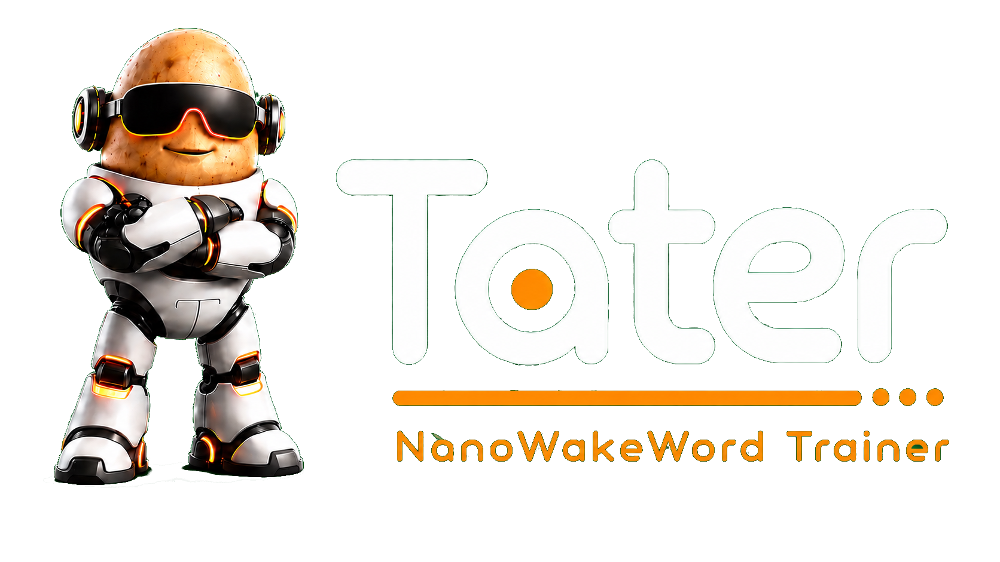

<div align="center">
  <a href="https://taterassistant.com">
    
  </a>
</div>
<h3 align="center">
  <a href="https://taterassistant.com">taterassistant.com</a>
</h3>

# Tater NanoWakeWord Trainer

A small web trainer for building NanoWakeWord models that Tater satellites can use through Tater's remote NanoWakeWord server.

The app follows the same basic contract as the Tater openWakeWord trainer:

- upload positive wake clips
- upload negative clips
- accept captured raw audio from firmware
- start a training job
- stream logs in the browser
- expose trained artifacts from `/api/artifacts`

Tater can load this trainer from the **Voice Models -> NanoWakeWord Trainer** panel.

## Run Locally

```bash
./run.sh
```

Default URL:

```text
http://127.0.0.1:8792
```

## Train

Open the UI, enter a wake phrase, and start training. For a model intended for
real use, upload at least a few positive recordings from the target satellite
and a varied set of normal-room/false-wake negatives; synthetic speech alone
cannot represent every microphone, room, and speaker.

The normal training run uses the higher-quality NanoWakeWord recipe by default:

- 2,500 synthetic positive samples
- 5,000 synthetic adversarial negative samples
- 3,000 phoneme hard-negative samples
- 2,000 validation positive/negative samples
- stronger augmentation and validation-aware training defaults
- `num_workers=0` by default for better stability in Docker/GPU runs
- automatic CUDA or Apple Metal (MPS) model training when available; feature
  extraction stays on the CPU ONNX path by default so training matches
  satellite inference (`NWW_FEATURE_DEVICE=gpu` remains an expert override)
- two validated architecture choices: CNN for higher recall and GRU for lower
  false-trigger behavior; DNN and the unvalidated upstream architectures are
  intentionally not offered
- a streaming quality gate that automatically calibrates thresholds from
  `0.90` through `0.99` and two through five consecutive detections, then
  stores the selected policy with the model for Tater satellites

The large openWakeWord ACAV100M negative bank is independently provisioned,
checksummed, and included even when openWakeWord is not selected. An existing
OWW copy can be adopted without another 17 GB copy. These additional
Colab-style banks are also included when present in `feature_banks/`:

```text
AE29H_float32.npy
RACON_11h_v1.npy
openwakeword_features_ACAV100M_2000_hrs_16bit.npy
```

Generated TTS clips are reused when the phrase and requested sample count have
not changed, including after an app update. Feature fingerprints automatically
rebuild stale `.npy` files when source audio, background/RIR clips, or the
augmentation recipe changes. **Regenerate feature files** remains available as
an explicit full rebuild when troubleshooting.

When launched by either Tater WakeWord Trainer, `--positive-tts-dir` reuses
that app's already quality-checked generated positive corpus instead of making
a duplicate NanoWakeWord corpus. Uploaded positives remain a separate balanced
source, reviewed negatives remain a separate hard-negative source, and
NanoWakeWord still creates independent held-out validation speech plus its own
adversarial and phonetic negatives.

Positive TTS and negative TTS have separate cache fingerprints. A same-phrase
app update keeps the expensive positive voice set, while a changed
negative/near-match recipe rebuilds only that stale negative cache and its
features.

Feature arrays have their own recipe/source fingerprints. The trainer rebuilds
embeddings when augmentation logic, background/RIR audio, generated sample
counts, or uploaded personal clips change, without unnecessarily regenerating
the underlying positive TTS audio.

Long uploaded positive recordings are staged as speech-centered 1.6-second
clips. This prevents NanoWakeWord's random two-second crop from accidentally
labeling room tone as the wake word, while leaving the original upload intact.
Uploaded positive and negative clips receive extra augmentation and balanced
sampling so a small set of real satellite recordings is not drowned out by the
much larger synthetic corpus.
When at least five uploaded positives and five uploaded negatives are
available, a deterministic 20% device-audio holdout is kept out of training
and used as a separate runtime-path quality check.

Custom confusing phrases augment the automatic adversarial phrase generator;
they no longer replace its broader negative vocabulary. CNN training starts
with a stronger `0.70` negative-class loss bias and raises it to `0.75` during
a corrective retry when false triggers remain.

The generated ONNX model is tested from WAV audio through the same 80 ms
streaming feature path used by Tater. A run that misses too many validation wake
words, triggers on too many validation negatives, or silently completes zero
training steps is rejected; an existing published model is not overwritten.
The default gate requires at least 90% wake-word recall and prefers a buffered
policy with at least 95% recall and no more than a 5% trigger rate on the
deliberately confusable synthetic negatives. The exact threshold and patience
that pass this streaming gate are published with the ONNX model, so satellites
run the same policy that was validated.
The synthetic negative set is intentionally packed with close phonetic decoys
(some are indistinguishable homophones), so its allowed trigger rate is 10%.
Uploaded real-room negatives are held to a stricter zero-trigger gate.
When personal positive and negative recordings are supplied, those originals
also receive a runtime-path sanity check so feature generation cannot hide a
model that fails on the user's actual satellite recordings.

If the first runtime gate finds missed wake clips or false-trigger clips, the
trainer automatically gives those failures a separate, balanced sampler and
performs up to two corrective retraining passes. Each retry is tested against a disjoint
validation partition so it cannot pass by memorizing the exact gate failures.
No artifact is published unless that fresh partition passes; both quality
reports remain with the training output.

Use `--validate-existing-candidate` to run the expanded policy search against
an existing ONNX candidate and export it when it passes, without repeating the
full training run.

For early real-room tests, add false wakes and normal room audio to `negative_samples/` before retraining. Pure synthetic data can pass training loss while still false-triggering on satellite microphone audio.

The trainer writes generated configs and model outputs under:

```text
output/
trained_wake_words/
```

Tater reads available model artifacts from:

```text
/api/artifacts
```

Supported exported model extensions:

```text
.onnx
.pt
.pth
```

## Docker

```bash
docker build -f dockerfile -t tater-nanowakeword-trainer .
docker run --rm -it -p 8792:8792 -v "$PWD:/data" tater-nanowakeword-trainer
```

NVIDIA build:

```bash
docker build -f Dockerfile.nvidia -t tater-nanowakeword-trainer:nvidia .
docker run --rm -it --gpus all -p 8792:8792 -v "$PWD:/data" tater-nanowakeword-trainer:nvidia
```

The GitHub workflow publishes the NVIDIA image to:

```text
ghcr.io/tatertotterson/nanowakeword-trainer:nvidia
```

## Notes

NanoWakeWord currently does not have a broad public pretrained wake-word catalog like openWakeWord, so this trainer is the intended path for custom wake words.
